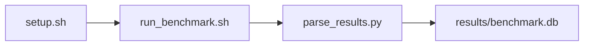

# KV Cache Stress Test Benchmark

[](LICENSE)
[](https://github.com/garys-gpu-benchmarks/127-gpu-bench-amd-vllm-kvcache-stress-ubu2404/actions/workflows/ci.yml)

Target: Ubuntu 24.04 · AMD · see Hardware Requirements. This is a host benchmark, not a laptop `pip install` project.

## Quick Start

```bash
git clone https://github.com/garys-gpu-benchmarks/127-gpu-bench-amd-vllm-kvcache-stress-ubu2404.git
cd 127-gpu-bench-amd-vllm-kvcache-stress-ubu2404
sudo bash setup.sh --assume-yes
bash run_benchmark.sh --profile smoke --validate
```
Results are written to `results/benchmark.db` and `results/summary.json`.

This workload is executed on the validation host after the repository is copied there. `setup.sh` and `run_benchmark.sh` do not open an outbound SSH session.

Prerequisites: Ubuntu 24.04; AMD; Python 3.12.3; root or sudo for `setup.sh`. Framework: Bash, SQLite, Python, PyYAML, ROCm Runtime, PyTorch-ROCm, Hugging Face Transformers, vLLM, Mistral-7B-v0.3. Set HF_TOKEN when the model license requires a Hugging Face token. This is a host benchmark, not a laptop `pip install` project.



## Download as a Bundle

This repository is one of the 32 workloads in the AMD Ubuntu 24.04 bundle, [`bundle-amd-ubuntu-2404`](https://github.com/garys-gpu-benchmarks/bundle-amd-ubuntu-2404), which holds them as git submodules pinned to a release. To put every workload for this platform on a GPU host in one step:

```bash
git clone --recurse-submodules https://github.com/garys-gpu-benchmarks/bundle-amd-ubuntu-2404 /opt/benchmarks
cd /opt/benchmarks
./run.sh list                                   # every workload should show "ready"
cd /opt/benchmarks/127-gpu-bench-amd-vllm-kvcache-stress-ubu2404
bash run_benchmark.sh --profile smoke --validate
```

To move to the newest published release later: `cd /opt/benchmarks && git pull && git submodule update --init --recursive`.

| Bundle repository | Platform | Workloads |
|---|---|---|
| [`bundle-amd-ubuntu-2404`](https://github.com/garys-gpu-benchmarks/bundle-amd-ubuntu-2404) | AMD · Ubuntu 24.04 | 101–132 |
| [`bundle-nvidia-ubuntu-2404`](https://github.com/garys-gpu-benchmarks/bundle-nvidia-ubuntu-2404) | NVIDIA · Ubuntu 24.04 | 201–232 |
| [`bundle-amd-ubuntu-2604`](https://github.com/garys-gpu-benchmarks/bundle-amd-ubuntu-2604) | AMD · Ubuntu 26.04 | 301–332 |
| [`bundle-nvidia-ubuntu-2604`](https://github.com/garys-gpu-benchmarks/bundle-nvidia-ubuntu-2604) | NVIDIA · Ubuntu 26.04 | 401–432 |

## Suite Tools

Three operator scripts from [`garys-gpu-benchmarks/gpu-bench-suite`](https://github.com/garys-gpu-benchmarks/gpu-bench-suite) work across the whole bundle. `run_benchmark_suite.sh` is also at the top of every bundle; each script prints full usage with `--help`.

- **`run_benchmark_suite.sh`** (on the GPU host) — runs the installed workloads one after another for each profile, writes one log to `/opt/benchmarks/benchmark_suite_log/`, and ends with a pass/fail summary.
  ```bash
  cd /opt/benchmarks
  ./run_benchmark_suite.sh --dry-run                    # list what would run
  ./run_benchmark_suite.sh -w 127 -p smoke,baseline   # just this workload
  ./run_benchmark_suite.sh -p smoke                     # every workload, smoke profile
  ./run_benchmark_suite.sh -r 20                        # soak: everything, 20 times
  ```
- **`get_remote_info.sh`** (on your laptop; Git Bash on Windows) — over one SSH connection, copies the runtime ledger and every workload's `results/raw`, `results/parsed` and suite logs into `RUNTIME_LEDGERS/` and `DIRECTORIES/`.
  ```bash
  git clone https://github.com/garys-gpu-benchmarks/gpu-bench-suite && cd gpu-bench-suite
  ./scripts/get_remote_info.sh 203.0.113.10                     # root@host, port 22
  ./scripts/get_remote_info.sh -i ~/.ssh/id_ed25519 -o ~/results ubuntu@203.0.113.10 2222
  ```
- **`show_metrics.sh`** (laptop or GPU host) — prints one workload's runs from the runtime ledger in fixed-width metric columns with per-profile means.
  ```bash
  ./scripts/show_metrics.sh 127 --host 203.0.113.10            # over SSH, all profiles
  ./scripts/show_metrics.sh 127 --baseline --file RUNTIME_LEDGERS/<ledger>.csv
  ```

## 1. Overview

Starts python -m vllm.entrypoints.openai.api_server with mistralai/Mistral-7B-v0.3 on 127.0.0.1:8000 for every profile, waits for /v1/models, runs scripts/benchmark_serving.py once, then stops the server. input_len, output_len, num_prompts, concurrency, and max_model_len come from yaml. output_format: csv Sweep dimensions: model_name, dtype, kv_cache_dtype, gpu_memory_utilization, max_model_len, input_len, output_len, num_prompts.

## 2. What It Validates

- Validates decode throughput, TTFT, TPOT, and KV-cache occupancy from the real vLLM OpenAI server. Every profile starts python -m vllm.entrypoints.openai.api_server
- #1: Decode throughput, tokens/s (output_tokens_per_sec); is present and physically sensible.
- #2: Time To First Token, ms (ttft_msec); is present and physically sensible.
- #3: TPOT, ms (tpot_msec); is present and physically sensible.
- #4: Peak KV-cache usage, GiB (kv_cache_peak_gb); is present and physically sensible.
- #5: KV-cache usage peak, pct (kv_cache_usage_peak_pct) is present and physically sensible.

## 3. Metrics Captured

- **#1: Decode throughput, tokens/s** — stored as `output_tokens_per_sec`.
- **#2: Time To First Token, ms** — stored as `ttft_msec`.
- **#3: TPOT, ms** — stored as `tpot_msec`.
- **#4: Peak KV-cache usage, GiB** — stored as `kv_cache_peak_gb`.
- **#5: KV-cache usage peak, pct** — stored as `kv_cache_usage_peak_pct`.

## 4. Hardware Requirements

### Supported environment

- OS: Ubuntu 24.04
- GPU vendor: AMD
- Framework family: Bash, SQLite, Python, PyYAML, ROCm Runtime, PyTorch-ROCm, Hugging Face Transformers, vLLM, Mistral-7B-v0.3
- Python: Python 3.12.3

### Reference validation environment

The tables below describe the machine used to generate the reference results. They are not a requirement that every user buy that exact cloud instance.

### System

Ubuntu 24.04 / AMD / Bash, SQLite, Python, PyYAML, ROCm Runtime, PyTorch-ROCm, Hugging Face Transformers, vLLM, Mistral-7B-v0.3

### GPU

Ubuntu 24.04 / AMD / Bash, SQLite, Python, PyYAML, ROCm Runtime, PyTorch-ROCm, Hugging Face Transformers, vLLM, Mistral-7B-v0.3

## 5. Software Requirements

| Component | Version |
|---|---|
| OS | Ubuntu 24.04 |
| Kernel | kernel 6.8.0 |
| Python | Python 3.12.3 |
| ROCm | ROCm 7.2.1 |
| rocBLAS | N/A - rocBLAS not used |

Starts python -m vllm.entrypoints.openai.api_server with mistralai/Mistral-7B-v0.3 on 127.0.0.1:8000 for every profile, waits for /v1/models, runs scripts/benchmark_serving.py once, then stops the server. input_len, output_len, num_prompts, concurrency, and max_model_len come from yaml. output_format: csv

## 6. Installation

```bash
Start python -m vllm.entrypoints.openai.api_server on port 8000, then run scripts/benchmark_serving.py
```

## 7. Running the Benchmark

```bash
Start python -m vllm.entrypoints.openai.api_server on port 8000, then run scripts/benchmark_serving.py
```

**Validating results separately:**

```bash
export BENCHMARK_PYTHON=/usr/bin/python3.13  # optional
python3 -m venv .venv
source ".venv/bin/activate"
".venv/bin/python" scripts/validate_results.py
```

## 8. Output

### `results/benchmark.db` (SQLite)

raw_results.csv written twice with the same serving summary, plus a short concurrency text log

sample_index,status,sustained_decode_throughput_under_cache_pressure_tokens_s,time_to_first_token_ms,time_per_output_token_under_high_kv_pressure_ms,kv_cache_hbm_usage_gb,kv_cache_hbm_capacity_utilization,tokens_per_sec,decode_tokens_per_sec,output_tokens_per_sec,ttft_ms,ttft_msec,tpot_ms,tpot_at_measured_kv_occupancy_ms,tpot_msec,kv_cache_gb,kv_cache_peak_gb,kv_util_percent,kv_cache_usage_peak_pct,error_message
0,ok,40,25,12,8,20,40,40,40,25,25,12,12,12,8,8,20,20,

```bash
Start python -m vllm.entrypoints.openai.api_server on port 8000, then run scripts/benchmark_serving.py
```

### `results/summary.json`

Consolidated metrics from the most recent run — suitable for CI artifact upload or dashboard ingestion.

### `results/raw/<timestamp>.txt`

raw_results.csv written twice with the same serving summary, plus a short concurrency text log

sample_index,status,sustained_decode_throughput_under_cache_pressure_tokens_s,time_to_first_token_ms,time_per_output_token_under_high_kv_pressure_ms,kv_cache_hbm_usage_gb,kv_cache_hbm_capacity_utilization,tokens_per_sec,decode_tokens_per_sec,output_tokens_per_sec,ttft_ms,ttft_msec,tpot_ms,tpot_at_measured_kv_occupancy_ms,tpot_msec,kv_cache_gb,kv_cache_peak_gb,kv_util_percent,kv_cache_usage_peak_pct,error_message
0,ok,40,25,12,8,20,40,40,40,25,25,12,12,12,8,8,20,20,

## 9. Baselines / Thresholds

Expected ranges and gates live in `config/benchmark_config.yaml` under `baselines:` or `thresholds:`. To update them, edit that file — never edit validation code directly.

## 10. Troubleshooting

**`setup.sh` missing collector**
Create cannot finish without `scripts/collect_workload.py`.

**`self_check` overlay rewritten**
Do not overwrite files listed in `results/overlay_lock.json`.

**Remote SSH drop during setup**
Reconnect and resume `bash setup.sh --assume-yes`. Do not wipe `.venv` or `.cache`.

## 11. NVIDIA H100 Coding Differences

Primary target is AMD ROCm. NVIDIA notes in this section are reference only and are not the execution path.

## Repository layout

```text
.
├── setup.sh
├── run_benchmark.sh
├── benchmark_specification.json
├── .github/workflows/      # thin CI callers (see Continuous Integration)
├── config/
├── scripts/
├── src/
├── tests/
├── docs/
├── results/
└── LICENSE
```

## Continuous Integration

| Workflow | Runs on | When | What it does |
|---|---|---|---|
| [CI](.github/workflows/ci.yml) | GitHub-hosted runner | every pull request, and every push to `main` | shellcheck, ruff, `bash -n`, `compileall`, `run_benchmark.sh --help`, specification schema, the results validator on a seeded fixture, required files, and actionlint. No GPU and no benchmark run. |
| [GPU Smoke Benchmark](.github/workflows/gpu-smoke.yml) | self-hosted runner labeled `gpu`, `amd`, `ubu2404` | only when started by hand: **Actions → GPU Smoke Benchmark → Run workflow** (choose `smoke`, `baseline` or `extended`) | Verifies the pre-provisioned GPU stack, records `results/environment.json` (driver, runtime, kernel, GPU), runs the profile with `--validate`, shows headline metrics on the run page, and uploads the results. |

Both files are short callers. The steps themselves live once, for every workload in the suite, in [`garys-gpu-benchmarks/shared-workflows`](https://github.com/garys-gpu-benchmarks/shared-workflows), pinned at `@v1`. The GPU workflow is never triggered by pull requests, so code from a fork cannot run on the GPU host.

The GPU Smoke Benchmark workflow runs one workload. To install and run the whole AMD Ubuntu 24.04 bundle by hand on the same machines, see [Download as a Bundle](#download-as-a-bundle) and [Suite Tools](#suite-tools).
